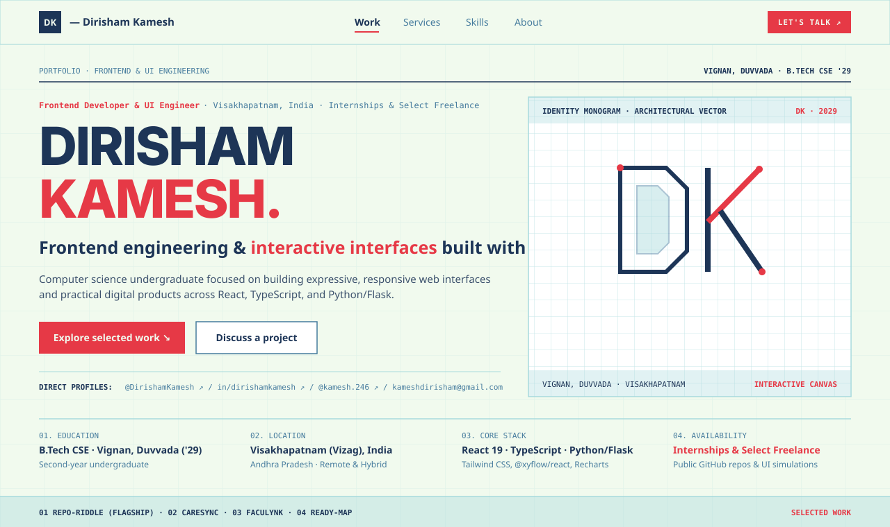
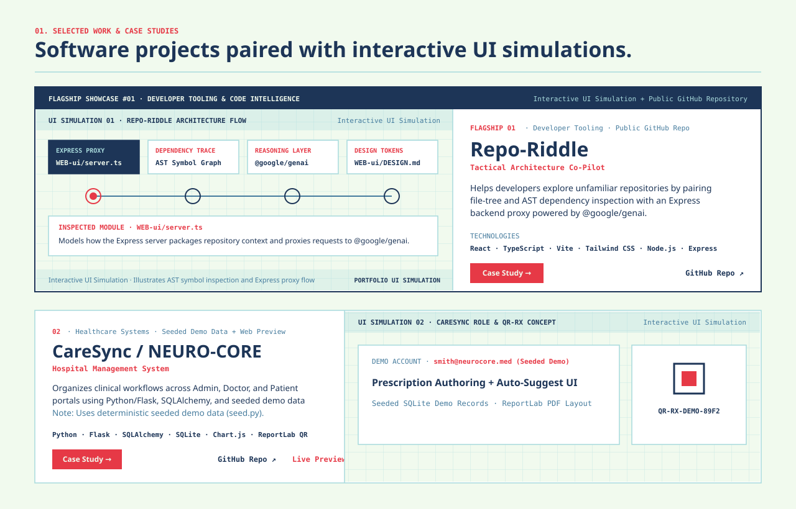

# Dirisham Kamesh — Personal Developer Portfolio

Personal portfolio and interactive engineering showcase of **Dirisham Kamesh**, a second-year Computer Science & Engineering (`B.Tech`, Class of 2029) undergraduate at **Vignan, Duvvada** (Visakhapatnam, India) focused on frontend development, UI engineering, responsive web interfaces, and full-stack software architecture.

---

## Visual Overview & Screenshots

### 1. Hero & Architectural Identity (`Syne` Display Typography + `DK` Vector Monogram)



### 2. Selected Work Gallery (Flagship #01 `Repo-Riddle` + Alternating Editorial Layout)



---

## Key Features & Design Architecture

- **Light Technical-Editorial Aesthetic**: Engineered around a disciplined 5-color palette:
  - **Honeydew (`#F1FAEE`)**: Primary canvas and light blueprint backdrop
  - **Oxford Navy (`#1D3557`)**: Display typography, structural headers, and primary interactive nodes
  - **Punch Red (`#E63946`)**: Primary call-to-action buttons, active indicators, and focal accents
  - **Cerulean (`#457B9D`)**: Secondary body copy, monospace metadata, and interactive outlines
  - **Frosted Blue (`#A8DADC`)**: Hairline structural dividers and schematic grid framing
- **Kinetic Typography & Motion System**:
  - **Syne** display introduction with a 3D perspective fold, split polygon `clip-path` unmasking, and optical focus-blur resolve.
  - Spring-driven magnetic buttons (`MagneticButton.tsx`), 3D pointer-reactive card tilt (`TiltCard3D.tsx`), scroll-triggered section reveals (`ScrollReveal.tsx`), and an opt-in Web Audio UI sound synthesizer (`lib/sound.ts`, muted by default).
  - Full `prefers-reduced-motion` compliance and keyboard accessibility across all interactive components.
- **Interactive UI Simulations (Client-Side Portfolio Prototypes)**:
  - Every featured project includes an interactive frontend UI simulation (`components/projects/ProjectVisual.tsx`) clearly labeled as an **Interactive UI Simulation** to illustrate the project's architecture alongside direct links to verified GitHub repositories and live previews.
- **Sticky Three-Zone Navigation Bar**:
  - **Left**: Compact `DK — Dirisham Kamesh` wordmark.
  - **Center**: `Work`, `Services`, `Skills`, and `About` with an animated active-section underline that tracks scroll position and `/work/[slug]` routes.
  - **Right**: Borderless social icon links on wide viewports and a prominent `LET'S TALK ↗` CTA, plus an accessible mobile navigation panel.
- **Validated Inquiry Composer with Transparent `mailto:` Fallback**:
  - Client-side validation (`lib/contact.ts`) with category selection (`Freelance Project`, `Internship Opportunity`, `Technical Collaboration`, `General Inquiry`), pre-formatted email draft generation, and one-click clipboard copy backup.

---

## Showcase Projects & Repository Inventory

### Part 1: Featured Case Studies (`/work/[slug]`)

| # | Project | Category | Status & Credibility Framing | Repository / Live Preview |
| :--- | :--- | :--- | :--- | :--- |
| **01** | **Repo-Riddle** *(Flagship)* | Developer Tooling & Code Intelligence | Flagship · Public GitHub Repo (In Progress) | [GitHub (`Repo-Riddlle-`)](https://github.com/DirishamKamesh/Repo-Riddlle-) |
| **02** | **CareSync / NEURO-CORE** | Healthcare Systems & Full-Stack Web | Public Repo · Seeded Demo Data (`seed.py`) + Static Web Preview | [GitHub (`Caresync`)](https://github.com/DirishamKamesh/Caresync) · [Live Preview (Netlify)](https://caresyncweb.netlify.app/) |
| **03** | **FacuLynk** | Academic Workflow & Frontend Architecture | Public GitHub Repo · React 19, Recharts & Firebase SDK | [GitHub (`FacuLynk`)](https://github.com/DirishamKamesh/FacuLynk) |
| **04** | **Ready-map** | Interactive Graph UI (`@xyflow/react`) | Local Prototype · GitHub Push Pending | Demonstrated via embedded Interactive UI Simulation |

### Part 2: Continuous Practice & Additional Repositories

- **[My_FSD_journey](https://github.com/DirishamKamesh/My_FSD_journey)** — Full-stack engineering logs, DOM exercises, and responsive CSS layouts (`HTML5`, `CSS3`, `JavaScript`).
- **[DSA_questions_java](https://github.com/DirishamKamesh/DSA_questions_java)** — Data structure implementations and OOP problem solving in `Java`.
- **[neetcode-submissions](https://github.com/DirishamKamesh/neetcode-submissions)** — Algorithmic practice covering Sliding Window, Two Pointers, Dynamic Programming, and Big-O analysis (`Java`, `C`).
- **[HackMate](https://github.com/DirishamKamesh/HackMate)** — Student hackathon team-building prototype ([Live Preview on Netlify](https://hackmatev1.netlify.app)).
- **[NetworX](https://github.com/DirishamKamesh/NetworX)** — Student developer network concept (`Node.js`, `Express`, `HTML/CSS/JS`).

---

## Tech Stack

- **Framework**: [Next.js 15](https://nextjs.org/) (App Router, Static & Dynamic Route Generation, TypeScript)
- **UI & Styling**: [React 19](https://react.dev/), [Tailwind CSS v4](https://tailwindcss.com/)
- **Animation & Choreography**: [Motion for React (`motion/react`)](https://motion.dev/)
- **Typography**: `Syne` (Display), `Plus Jakarta Sans` (Body), `JetBrains Mono` (Coordinates & Metadata) via `next/font/google`
- **Icons**: [Lucide React](https://lucide.dev/)

---

## Project Structure

```text
├── app/
│   ├── globals.css                 # Tailwind v4 imports & 5-color light palette tokens
│   ├── layout.tsx                  # Root layout, Google Fonts (Syne, Jakarta, JetBrains Mono), JSON-LD SEO
│   ├── not-found.tsx               # Custom 404 route
│   ├── page.tsx                    # Homepage route assembling header, main client, and footer
│   └── work/[slug]/page.tsx        # Dynamic case study routes with generateStaticParams()
├── components/
│   ├── HomePageClient.tsx          # Homepage section orchestrator & service inquiry state
│   ├── layout/
│   │   ├── SiteHeader.tsx          # Sticky 3-zone navbar & accessible mobile drawer
│   │   └── SiteFooter.tsx          # Footer with verified links & optional UI sound toggle
│   ├── projects/
│   │   ├── ProjectCard.tsx         # Flagship #01 & alternating editorial project cards
│   │   ├── ProjectDetailView.tsx   # Full engineering case study view
│   │   └── ProjectVisual.tsx       # 4 interactive client-side UI simulations
│   ├── sections/
│   │   ├── HeroSection.tsx         # Syne 3D clip-path hero introduction & DK monogram
│   │   ├── SelectedWorkSection.tsx # Project gallery, category filter, & practice strip
│   │   ├── ServicesSection.tsx     # Freelance capabilities & collaboration workflow
│   │   ├── SkillsSection.tsx       # Evidence-tiered technical skills matrix
│   │   ├── AboutAndProcessSection.tsx # Academic profile, resume status, & 6-stage process
│   │   └── ContactSection.tsx      # Validated inquiry form & mailto composer
│   └── ui/
│       ├── CustomCursor.tsx        # Fine-pointer desktop custom cursor
│       ├── DKMonogram.tsx          # Interactive architectural DK vector sculpture
│       ├── MagneticButton.tsx      # Spring-physics magnetic wrapper
│       ├── ScrollReveal.tsx        # Viewport intersection reveal wrapper
│       └── TiltCard3D.tsx          # Pointer-reactive 3D perspective card container
├── data/
│   ├── profile.ts                  # Centralized personal profile, education, & social links
│   ├── projects.ts                 # Audited case studies & secondary repository data
│   ├── services.ts                 # Freelance service offerings & workflow steps
│   └── skills.ts                   # Evidence-grouped technical skills
├── hooks/
│   ├── use-mobile.ts               # Mobile breakpoint hook (useSyncExternalStore)
│   ├── useFinePointer.ts           # Fine pointer detection hook
│   └── useReducedMotionPref.ts     # prefers-reduced-motion accessibility hook
├── lib/
│   ├── contact.ts                  # Form validation & mailto draft builder
│   ├── sound.ts                    # Opt-in Web Audio API subtle tactile click synthesizer
│   └── utils.ts                    # Classname merge helper
└── public/
    ├── favicon.svg                 # DK brand favicon
    ├── og-image.svg                # 1200x630 OpenGraph social preview card
    └── screenshots/                # High-resolution SVG interface previews for documentation
```

---

## Getting Started (Local Development)

### Prerequisites
- **Node.js** `>= 18.18.0` (Node 20+ recommended)
- **npm** (or `pnpm` / `yarn`)

### 1. Clone the Repository

```bash
git clone https://github.com/DirishamKamesh/dirisham-kamesh-portfolio.git
cd dirisham-kamesh-portfolio
```

### 2. Install Dependencies

```bash
npm install
```

### 3. Configure Environment Variables (Optional)

Copy `.env.example` to `.env.local` if you want to set a canonical production domain URL for SEO metadata:

```bash
cp .env.example .env.local
```

### 4. Start the Development Server

```bash
npm run dev
```

Open [http://localhost:3000](http://localhost:3000) in your browser.

### 5. Lint & Production Build Verification

```bash
npm run lint
npm run build
npm run start
```

---

## How Others Can Customize & Reuse This Template

All personal data, projects, skills, and services are cleanly decoupled from the React components inside `/data`:

1. **Profile, Education & Social Links**: Edit [`data/profile.ts`](./data/profile.ts) to update your name, university, bio paragraphs, email, GitHub, LinkedIn, Instagram, and resume PDF availability (`resume.available`).
2. **Showcase Projects & Case Studies**: Edit [`data/projects.ts`](./data/projects.ts) to update the featured case studies (`/work/[slug]`) and continuous practice repositories.
3. **Freelance Services**: Edit [`data/services.ts`](./data/services.ts) to customize service offerings and deliverables.
4. **Skills Matrix**: Edit [`data/skills.ts`](./data/skills.ts) to organize technologies under `"Used in projects"`, `"Working knowledge"`, or `"Currently learning"`.

---

## Contact & Verified Profiles

- **Author**: Dirisham Kamesh
- **Email**: [kameshdirisham@gmail.com](mailto:kameshdirisham@gmail.com)
- **GitHub**: [github.com/DirishamKamesh](https://github.com/DirishamKamesh)
- **LinkedIn**: [linkedin.com/in/dirishamkamesh](https://www.linkedin.com/in/dirishamkamesh/)
- **Instagram**: [instagram.com/kamesh.246](https://www.instagram.com/kamesh.246/) (`@kamesh.246`)
